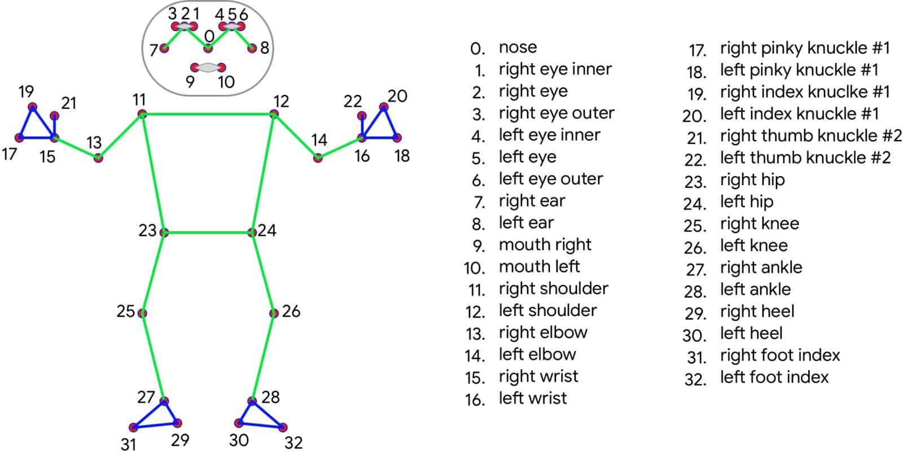

# OPI-Robotic-Arm-Control-Vision
## Geometry and Vision for Robotic Arm Control
Matemática pura que convierte los *landmarks* de MediaPipe (Pose y Hands) en cantidades útiles para controlar un brazo robótico: ángulos de articulaciones, rotación del torso y apertura de la pinza. No depende de OpenCV ni de hardware; solo usa la biblioteca estándar `math`.

# Módulo de matemáticas de detección de pose

## Propiedades matemáticas importantes

### Producto punto

Para dos vectores $\vec{v}_1$ y $\vec{v}_2$ con ángulo $\theta$ entre ellos:

$$
\vec{v}_1 \cdot \vec{v}_2 = |\vec{v}_1|\,|\vec{v}_2|\cos\theta
\quad\Longrightarrow\quad
\theta = \arccos\left(\frac{\vec{v}_1 \cdot \vec{v}_2}{|\vec{v}_1|\,|\vec{v}_2|}\right)
$$

### Magnitud (Pitagorazo, `math.hypot`)

$$
|\vec{v}| = \sqrt{v_x^2 + v_y^2} \quad \text{(2D)}
\qquad\qquad
|\vec{v}| = \sqrt{v_x^2 + v_y^2 + v_z^2} \quad \text{(3D)}
$$

### Ángulo en una articulación

Dados tres puntos $A$, $B$ (vértice) y $C$, se forman $\vec{v}_1 = A - B$ y $\vec{v}_2 = C - B$. El ángulo en $B$ es:

$$
\theta_B = \arccos\left(\text{clamp}\left(\frac{v_{1x}v_{2x} + v_{1y}v_{2y}}{|\vec{v}_1|\,|\vec{v}_2|},\ -1,\ 1\right)\right)\cdot\frac{180^\circ}{\pi}
\qquad \theta_B \in [0^\circ, 180^\circ]
$$

El `clamp` evita `ValueError` en `acos` cuando el error de punto flotante produce valores como $1.0000000002$.

### Rotación del torso

Con los hombros izquierdo y derecho (landmarks 11 y 12):

$$
\Delta x = x_R - x_L, \qquad
\Delta z = z_R - z_L, \qquad
\phi = \text{atan2}(\Delta z,\ \Delta x)
$$

### Tamaño de la mano y razón de pinza

El tamaño de referencia $s$ es la distancia muñeca (0) a nudillo del dedo medio (9). La distancia pulgar (4) a índice (8), $d_{4,8}$, se normaliza por $s$ y se mapea linealmente a $[0, 1]$:

$$
r = \text{clamp}\left(\frac{d_{4,8}/s - P_{\text{cerrada}}}{P_{\text{abierta}} - P_{\text{cerrada}}},\ 0,\ 1\right)
$$

Normalizar por $s$ hace que $r$ no dependa de qué tan cerca o lejos esté la mano de la cámara. $r = 0$ es la mano cerrada y $r = 1$ la mano abierta.

## Landmarks utilizados

## Constantes configurables

| Constante      | Valor | Significado |
|----------------|:-----:|-------------|
| `PINCH_CLOSED` | 0.75  | Razón normalizada bajo la cual la pinza se considera totalmente cerrada |
| `PINCH_OPEN`   | 0.90  | Razón normalizada sobre la cual la pinza se considera totalmente abierta |

Ajustar a ojo observando el valor de `PINZA` en la vista en vivo.

## Funciones

| Función | Qué hace | Regresa |
|---------|----------|---------|
| `clamp(val, lo, hi)` | Limita un valor al rango $[lo, hi]$ | Número |
| `pick_arm(pose)` | Elige el brazo mejor visto en el frame | `(cadera, hombro, codo, muñeca, etiqueta)` |
| `joint_angle_deg(a, b, c)` | Ángulo en `b` entre $b \to a$ y $b \to c$ | Grados en $[0, 180]$ o `None` |
| `shoulder_rotation_deg(pose)` | Giro del torso con la $z$ de los hombros | Grados o `None` |
| `hand_size(hand)` | Distancia muñeca–nudillo medio | Distancia en coordenadas de imagen |
| `pinch_ratio(hand)` | Apertura de la pinza normalizada | $0.0$ (cerrada) a $1.0$ (abierta) |
